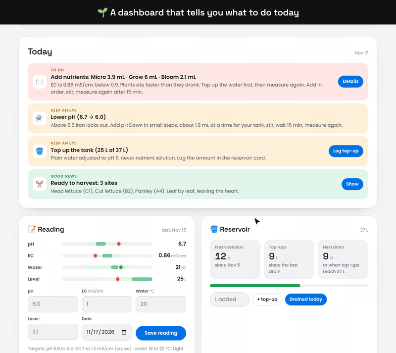
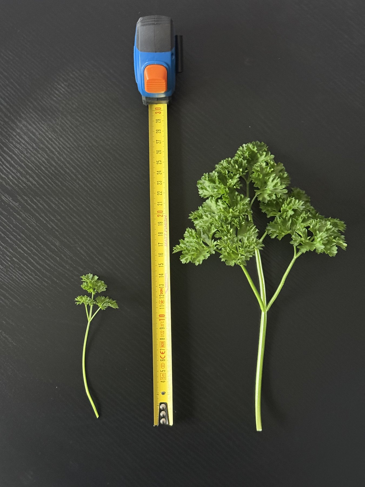
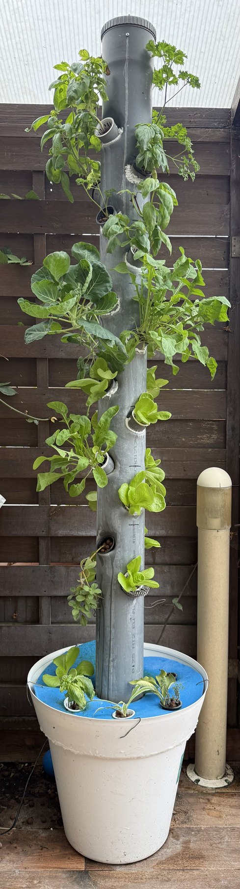
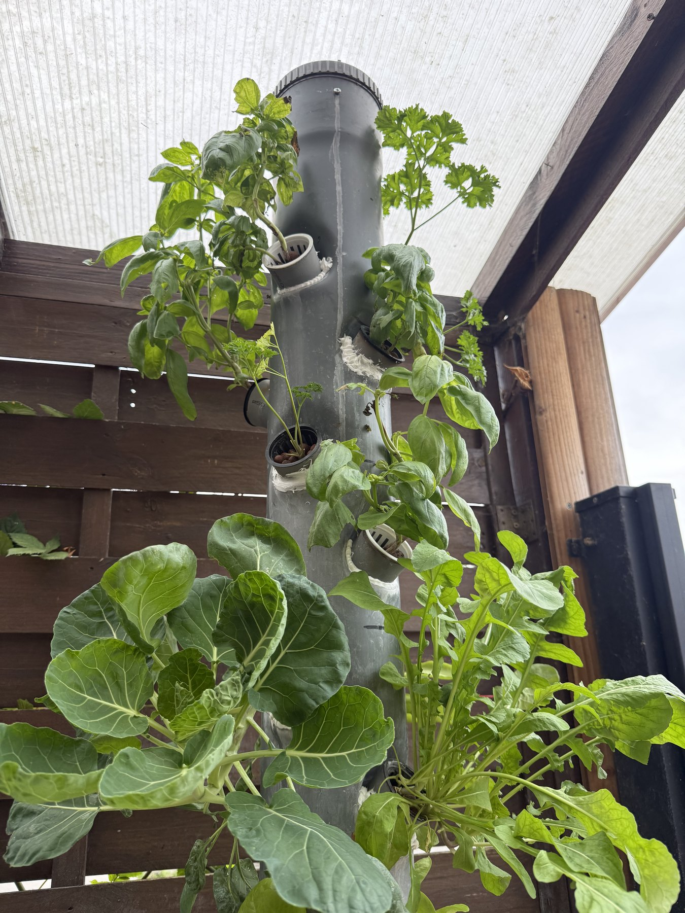
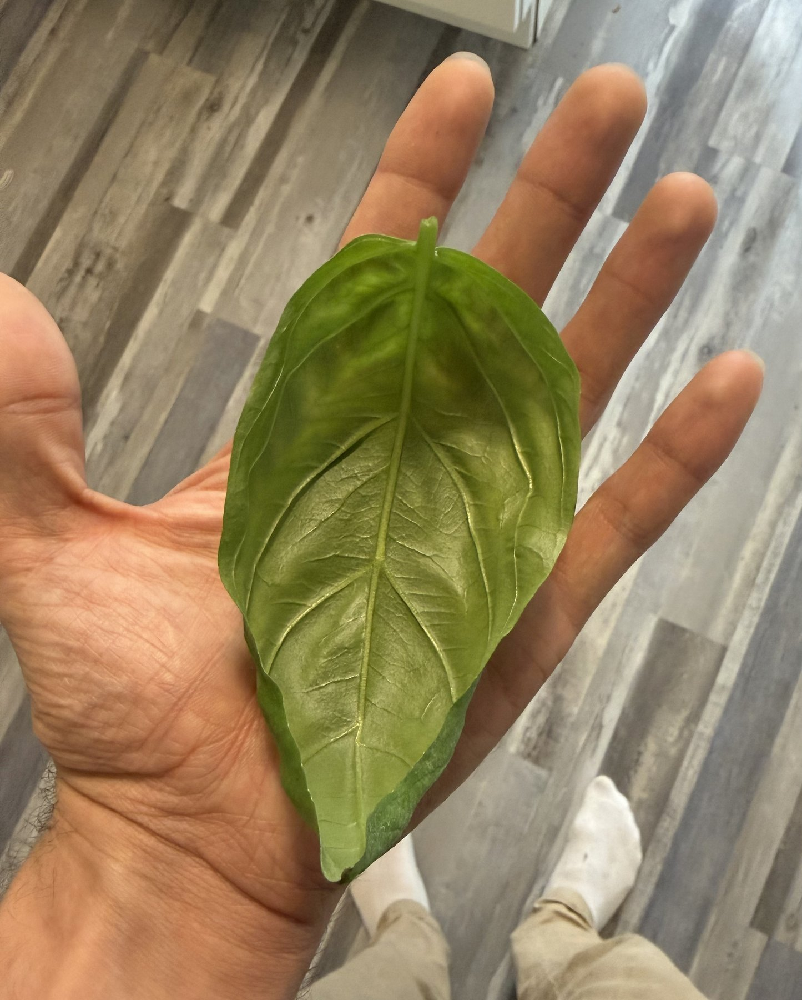

# Hydroponic for Black Thumbs

> I couldn't even grow parsley. So I asked Claude for help… and things got a little out of hand.

A home-built, 24-site hydroponic tower, the growing method that keeps it alive, a dashboard that tells you what to do today, a Claude plugin that sets that dashboard up for your own tower, and the (still untested) electronics and firmware meant to automate it. Everything here was worked out in conversation with Claude by someone who started with zero hydroponics knowledge.

This is an independent community project. It is not affiliated with or endorsed by Anthropic.

<p align="center">
  
</p>

<p align="center"><em>The dashboard: type your readings, it tells you what to do today. Runs on demo data until you press "Start fresh". <a href="dashboard/">Get it</a> or let the <a href="plugins/hydroponic-for-black-thumbs/">Claude plugin</a> set it up for your tower.</em></p>

<h3 align="center">The results</h3>

<p align="center">
  
</p>

<p align="center"><em>Two neighbouring parsley plants, one stem cut from each. Soil on the left, tower on the right.</em></p>

<p align="center">
  
  
  
</p>

## What works and what doesn't (yet)

Read this table before you copy anything.

| Part | Status |
|---|---|
| The tower: 24 sites, one shared reservoir, leafy greens and herbs | Running since September 2026 |
| [Growing guide](docs/growing-guide.md): doses, mixing order, routine, troubleshooting | In daily use on the real tower |
| [Dashboard](dashboard/): enter pH / EC / level, get today's actions | Rewritten in English from the one in daily use on the real tower |
| [Claude plugin](plugins/hydroponic-for-black-thumbs/): sets up the dashboard for your tower and coaches you | Works in the Claude app |
| [Automation plan](docs/automation-plan.md): sensors, dosing rules, safeguards | Designed, not built |
| [Wiring guide](docs/wiring.md): module-based controller, pin by pin | Designed, parts ordered, not assembled |
| [Custom PCB v1.1](docs/pcb.md) | Designed, [reviewed](hardware/pcb/docs/REVIEW-rev1.0.md), revised and [reviewed again](hardware/pcb/docs/REVIEW-rev1.1.md): **never fabricated, untested** |
| [Firmware](firmware/) for the ESP32: readings, web page, dosing with safeguards | Written, compiles, dosing logic covered by automated tests. **Never run on hardware** |

Building the tower itself is not covered: there are plenty of tutorials for that. This repository covers what comes after.

If you are an electronics engineer, the most useful thing you can do is review the schematic. See [CONTRIBUTING.md](CONTRIBUTING.md).

## The tower in numbers

| | |
|---|---|
| Sites | 24, in 4 columns of 6 |
| Reservoir | 37 L (started at 15 L, which drifted too fast) |
| Medium | Expanded clay pebbles, with a coco or rockwool plug at the collar |
| Nutrients | Terra Aquatica TriPart (Micro, Grow, Bloom) |
| Targets | EC 1.0 to 1.2 mS/cm, pH 6.0 (5.5 to 6.5 acceptable) |
| Light | Natural light only, under an open-sided shelter |
| Crops | Lettuce, basil, chives, parsley, lamb's lettuce, spinach |
| Routine | 3 minutes every 2 to 3 days; full drain every 15 to 21 days |

## Where to start

**I want to grow things.** Read the [growing guide](docs/growing-guide.md). You need a pH meter, an EC meter and pH Down. Nothing in it requires electronics.

**I want to try the dashboard.** Download [`dashboard/index.html`](dashboard/index.html) and open it in a browser. It starts with demo data, needs no server or account, and keeps your data in that browser.

**I want it in my own Claude.** Install the plugin (below). Claude asks a few questions about your tower, water and nutrients, creates your dashboard, and then advises you from your own readings.

**I want to automate.** Read the [automation plan](docs/automation-plan.md) first, safeguards included, then the [wiring guide](docs/wiring.md) and the [firmware](firmware/). The [PCB](docs/pcb.md) is optional and unproven.

**I want to know what it costs.** See [costs](docs/costs.md). Short version: the automation parts come to roughly €200.

## Use it with Claude

The plugin contains one skill, `hydroponic-tower-coach`.

**Claude apps, as a plugin** (paid plans): Customize → Plugins → Personal plugins → "+" → Add marketplace → Add from a repository, then paste this repository's URL and install `hydroponic-for-black-thumbs`.

**Claude apps, as a skill only** (all plans): download `hydroponic-tower-coach.zip` from the Releases page, then Customize → Skills → "+" → Create skill → Upload a skill.

**Claude Code:**

```
/plugin marketplace add RWBKI/hydroponic-for-black-thumbs
/plugin install hydroponic-for-black-thumbs@hydroponic-for-black-thumbs
```

Then say: "Set up my hydroponic tower dashboard."

Later, press "Copy summary for Claude" on the dashboard, paste it into a conversation and ask your question.

Menu names may change; see Anthropic's help pages on [skills](https://support.claude.com/en/articles/12512180-use-skills-in-claude) and [plugins](https://support.claude.com/en/articles/13851150-install-financial-services-plugins).

## Safety

- Water and electricity share a box in this project. No mains voltage goes inside the controller enclosure: the 12 V power brick stays dry, on an outdoor socket protected by an RCD/GFCI.
- pH Down is acid. Add it in small doses to the full volume of water, never to other concentrates.
- Automated dosing can kill a reservoir faster than neglect. The [safeguards](docs/automation-plan.md#safeguards-before-autonomy) are not optional.
- The doses in this repo were calibrated on one water supply and one EC pen. Measure yours.

## Licence

- Code (dashboard, firmware, plugin): [MIT](LICENSE)
- Hardware (schematic, PCB): [CERN-OHL-P v2](hardware/LICENSE)
- Documentation and photos: [CC BY 4.0](docs/LICENSE)

Copyright © 2026 RWBKI and contributors. To credit the project: "Hydroponic for Black Thumbs, by RWBKI and contributors", with a link to this repository.

## Origin

The project was first shared on r/ClaudeAI in November 2026. The questions asked there shaped this repository.
