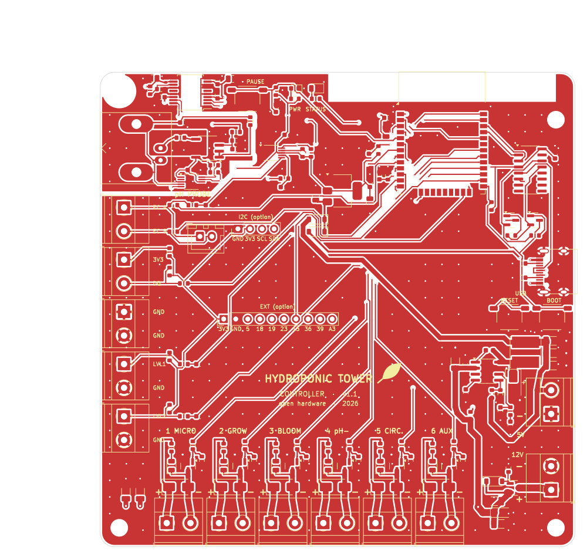

# Custom PCB v1.1

One 100 × 100 mm, 2-layer board meant to replace the ESP32 dev kit, the ADS1115 module, the buck converter, the relay block, the jumper wires and the small pH and TDS boards. Only the probes are kept.

## Status: reviewed twice, never built

**This board has never been fabricated. Nothing on it has been powered or measured.**

- Rev 1.0 was reviewed and found to have three major weaknesses. The [review](../hardware/pcb/docs/REVIEW-rev1.0.md) advised against ordering it.
- Rev 1.1, the version in this repository, changes the board to answer those three findings. A [second review](../hardware/pcb/docs/REVIEW-rev1.1.md) found no blocker and no major problem left, and lists what to test first on a real board.

Both reviews were made by separate AI sessions (Claude) that had not seen the design work. Neither is a review by a human electronics engineer. If you are one, your review is the most valuable contribution this project can receive: see [CONTRIBUTING.md](../CONTRIBUTING.md).

Rev 1.1 was edited by script, not in an interactive layout tool. The first board built from it is a prototype to be tested, not a finished product.

The module build in the [wiring guide](wiring.md) does not depend on this board.

## Files

| Path | Contents |
|---|---|
| [`hardware/pcb/kicad/`](../hardware/pcb/kicad/) | KiCad 7 project, with its custom design rules |
| [`hardware/pcb/fabrication/`](../hardware/pcb/fabrication/) | Gerbers and drill files, BOM and placement file for JLCPCB |
| [`hardware/pcb/docs/schematic.pdf`](../hardware/pcb/docs/schematic.pdf) | Schematic |
| [`hardware/pcb/docs/assembly.pdf`](../hardware/pcb/docs/assembly.pdf) | Assembly drawing |
| [`hardware/pcb/CHANGES.md`](../hardware/pcb/CHANGES.md) | What changed between rev 1.0 and rev 1.1 |
| [`hardware/pcb/docs/REVIEW-rev1.1.md`](../hardware/pcb/docs/REVIEW-rev1.1.md) | Review of this version, with the bench tests to run first |
| [`hardware/pcb/docs/REVIEW-rev1.0.md`](../hardware/pcb/docs/REVIEW-rev1.0.md) | Review of the previous version |
| [`hardware/pcb/tools/`](../hardware/pcb/tools/) | Scripts that re-check the isolation gap, the guard ring and schematic against board |



## What it is meant to do

```
MEASURE                                        DECIDE            ACT
                 isolated island
pH probe (BNC) ─ amplifier ─ ADS1115 ─ ║ ────┐
                              0x49     ║     │
                              isolator ║     ├─▶ ESP32 ─▶ 6 MOSFET outputs
EC probe ─ alternating excitation ─ ADS1115 ─┤   Wi-Fi     ├ 4 dosing pumps
DS18B20 temperature ─────────── 0x48 ────────┤   BLE       ├ circulation
2 float switches ────────────────────────────┤             └ 1 spare
12 V rail voltage ───────────────────────────┘

POWER: 12 V supply ─▶ reverse-polarity + TVS ─▶ 12→5 V buck ─▶ 5→3.3 V
       USB-C for programming
```

| Feature | Detail |
|---|---|
| MCU | ESP32-WROOM-32E |
| pH front end | MCP6002 buffer and its own ADS1115 (0x49) on an isolated island, fed through an ADM3260 isolator |
| EC | Two GPIOs driven alternately through limiting resistors, read by a second ADS1115 (0x48) on the main side |
| Outputs | 6 MOSFET-switched 12 V outputs, PWM capable |
| Power | TPS54331 buck converter, LDL1117S33R regulator, reverse-polarity and TVS protection |
| USB | USB-C, CH340C, auto-reset |
| Extras | 12 V rail sensing, pause button, status LED, I2C and GPIO expansion headers, 5 V output |
| Mechanical | 100 × 100 mm, 4 M3 holes, screw terminals around the edge |

## Why the pH stage is isolated

The pH electrode and the EC electrodes sit in the same liquid. On rev 1.0 they also shared the board's ground, so any current leaving an EC pin could return through the pH reference junction and shift the reading by several pH. Keeping the EC pins floating in firmware hides the problem; it does not remove it.

On rev 1.1 the pH amplifier, its reference and its converter have their own ground, which follows the liquid. The only parts that cross to the rest of the board are inside the isolator.

```
        ISLAND (follows the liquid)          │ 1 mm │        MAIN BOARD
                                             │ gap  │
 BNC ─ guard ring ─ amplifier ─ ADS1115 ─────┤ U8   ├──── I2C ─── ESP32
                                 0x49        │ ADM  │
 GND_ISO   +3V3_ISO ◀────────────────────────┤ 3260 ├──── +3V3, GND
                                             │      │
                                                          EC pins, pumps, USB
```

## The three findings of the first review

| # | Rev 1.0 | Rev 1.1 | Second review |
|---|---|---|---|
| 1 | The pH guard ring was not a ring: ground copper sat 0.30 mm from the high-impedance input | Guard closed around the input on both layers; ground copper now 1.33 mm away, behind the guard | Resolved |
| 2 | pH and EC shared the liquid and the board ground | pH stage isolated, as above | Resolved on the board; to confirm on the bench |
| 3 | The 3.3 V regulator was fed below its minimum input voltage | Regulator replaced by a low-dropout part with the same footprint | Resolved |

## What has been checked

- **Schematic equals layout:** 434 pins compared, 0 differences. 152 components.
- **Only the intended nets changed:** ten pins of existing parts, all on purpose. No existing part moved.
- **Isolation gap:** at least 1.00 mm between island copper and the rest, on both layers, measured independently of the design-rule check. The isolator is the only part with pins on both sides.
- **Guard ring:** closed on both layers. Narrowest section 0.44 mm, between the BNC centre pin and its shield pin.
- **Design rules** (KiCad 7.0.11, with the project's custom rules): 0 errors and 0 unconnected pads, on the board as saved and after a zone refill. The warnings left are footprints without a library link and connector outlines that overhang the board edge.
- **Datasheets:** every pin of the isolator, the regulator pin-out, the converter addresses.
- **Fabrication files:** the Gerbers match the saved board; BOM and placement file list each of the 145 assembled parts once.

You can repeat the first four with the scripts in [`hardware/pcb/tools/`](../hardware/pcb/tools/).

## What has not been checked

- No board has been powered. Nothing has been measured.
- The isolator contains a small switching supply 10 mm from the pH input. Its effect on the reading is unknown until measured.
- Electrical rule check: not available in the KiCad version used.
- Part orientation in the placement file against the assembler's library: only visible in the assembler's preview.
- Buck converter stability and noise, radio performance.

The [review](../hardware/pcb/docs/REVIEW-rev1.1.md) leaves 4 minor findings and 12 notes open, and lists five bench tests in the order to run them.

## Module build versus this board

| | Modules | PCB |
|---|---|---|
| Wires to connect | about 50 | 13 screw terminals |
| Solder joints | about 30 | 0 (factory assembled) |
| Footprint | 30 × 21 cm | 10 × 10 cm |
| Assembly time | about 1 day | about 30 min |

## Cost estimate

Quoted for rev 1.0 from JLCPCB's price grid, converted at the 12 October 2026 rate (€1 = $1.12). Indicative only.

| Quantity | Order total | Per board |
|---|---|---|
| 2 boards, assembled, delivered to the EU, VAT and duty included | about €100 | about €50 |
| 5 boards, same conditions | about €153 | about €31 |

Rev 1.1 has not been re-quoted. It adds 12 parts (145 placed components, 48 BOM lines). The isolator is the expensive one, between $6 and $9 at LCSC on 15 November 2026, and stock was low. Expect roughly €10 to €15 more per board.

For a single controller the module build is cheaper (about €34 of modules). Probes are not included.

## Pin map

```c
// Custom PCB v1.1 (firmware/include/board.h)
#define PIN_PUMP_MICRO     16
#define PIN_PUMP_GROW      17
#define PIN_PUMP_BLOOM     26
#define PIN_PUMP_PH_DOWN   27
#define PIN_CIRCULATION    13
#define PIN_AUX            12  // strapping pin: LOW at boot
#define PIN_DS18B20         4
#define PIN_LEVEL_LOW      32  // float closed = LOW
#define PIN_LEVEL_EMPTY    33
#define PIN_BTN_PAUSE      34  // pressed = LOW
#define PIN_LED_STATUS      2
#define PIN_SENSE_12V      35  // V12 = pin millivolts x 115 / 15
#define PIN_EC_A           25  // EC excitation (alternate with EC_B)
#define PIN_EC_B           14
#define PIN_I2C_SDA        21
#define PIN_I2C_SCL        22
// ADS1115 at 0x49 (isolated): A0 = BNC shield, A1 = pH amplifier, read as A0 - A1
// ADS1115 at 0x48 (main side): A2 = EC, A3 = spare input
```

## Firmware on this board

The [firmware](../firmware/) builds for this board with `pio run -e pcb`. Differences from the module build:

| | Modules | PCB |
|---|---|---|
| Pumps | Relays, active low | MOSFETs, HIGH = on |
| pH | pH board on one ADC input | Isolated ADS1115 at 0x49, differential A0 − A1. The sign is inverted; two-point calibration absorbs it |
| EC | Analog TDS module | **Not implemented.** The on-board EC circuit must be characterised on a real board first. Its pins are left floating |
| 12 V rail | Not measured | Read on GPIO35 |

## Requirements if you build it

- Regulated 12 V supply only. An unregulated adapter that idles above about 16 V will destroy the input protection.
- Keep the total load to about 2 A.
- The BNC body is part of the isolated island: keep it away from any metal panel or enclosure.
- Use a nylon screw and spacer at the mounting hole next to the BNC (H1).
- The isolation is for measurement only. It is not a safety barrier.
