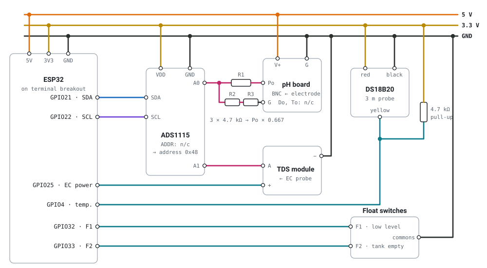
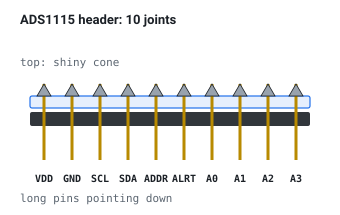
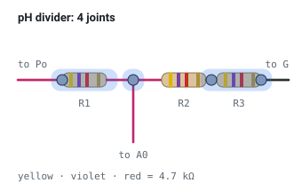
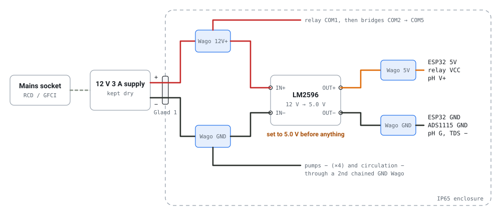
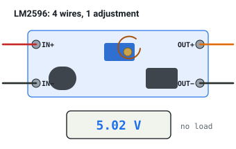
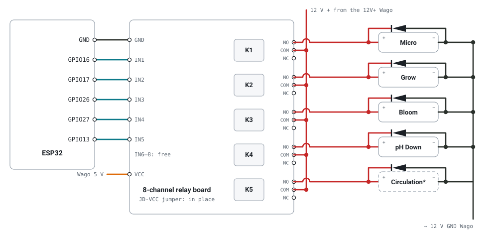
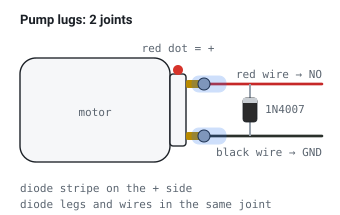
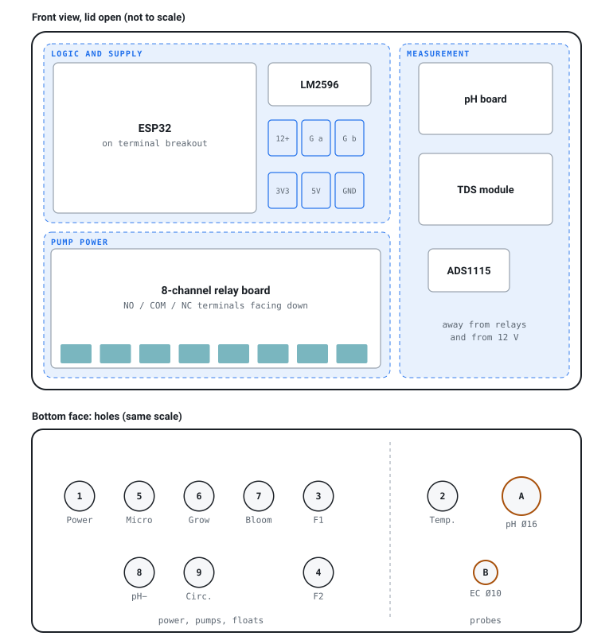
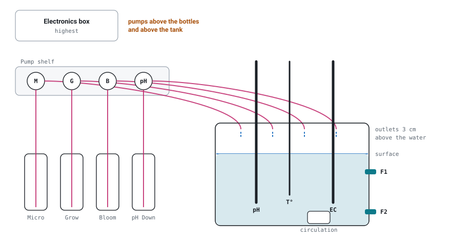

# Wiring guide (module version)

Every wire, terminal and solder joint for a controller built from off-the-shelf modules. Phase 1 measures, phase 2 doses. Wire everything on the bench first, then in the enclosure.

**Status: designed, parts ordered, not assembled yet.** Expect corrections once it is built.

| | |
|---|---|
| ESP32 pins used | 16 |
| Lever connectors (Wago 221) | 6 |
| Solder joints | about 30 |
| Cable entries | 11 |

## Parts this guide assumes

ESP32-WROOM-32D DevKit V4 on a 38-pin screw-terminal breakout, ADS1115, analog pH board with BNC electrode, analog TDS module, DS18B20 (3 m), 2 side-mount float switches, 8-channel 5 V relay board, 12 V 3 A power supply, LM2596 buck converter, 4 Kamoer KEF 12 V peristaltic pumps.

If a board you received does not match its description, stop and check before wiring.

## Before you start

**Tools:** multimeter (required), 40 to 60 W soldering iron with a fine tip, wire stripper, 2.5 mm flat screwdriver, drill with 12.5 mm bit for cable glands and 10 and 16 mm for the probe holes.

**Consumables often missing from a parts order:**

| Item | Use |
|---|---|
| 10 Wago 221-415 | The 3.3 V, 5 V, GND and 12 V "rails" |
| 1N4007 diodes | One per pump, phase 2 |
| 2 × 0.5 mm² round cable, 10 m | Pumps and float extensions |
| Heat-shrink tubing | Insulate every joint |
| Neutral silicone sealant | Seal the two probe holes |

**Four rules that keep things from burning:**

1. Always wire with power off: USB unplugged, 12 V unplugged.
2. Connect nothing to the LM2596 output before reading 5.0 V on it with a multimeter. Out of the box it often outputs 12 V.
3. Never USB and the LM2596 on the ESP32 at the same time. To flash over USB, unplug the 12 V.
4. No mains voltage in this enclosure. The 12 V brick stays dry, on an outdoor socket with RCD/GFCI protection.

## All connections

### ESP32 breakout terminals

Phase 2 rows are marked (P2). Leave them empty in phase 1.

| Terminal | What goes in | Why |
|---|---|---|
| 3V3 | 1 wire to the 3.3 V Wago | Powers the ADS1115 and the temperature probe |
| 5V | 1 wire to the 5 V Wago | Phase 1: outputs USB 5 V. Phase 2: receives 5 V from the LM2596 |
| GND 1 | 1 wire to the GND Wago | Common ground |
| GND 2 | DS18B20 black wire, relay board GND (P2) | |
| GND 3 | Common wires of both floats, twisted together | |
| G21 | ADS1115 SDA | I2C data |
| G22 | ADS1115 SCL | I2C clock |
| G4 | DS18B20 yellow wire and one leg of a 4.7 kΩ resistor | 1-Wire bus |
| G25 | TDS module + | Powers the EC module only during a measurement |
| G32 | Float F1, second wire | Low level: notification |
| G33 | Float F2, second wire | Tank empty: pumps stop |
| G16 | Relay IN1 (P2) | Micro pump |
| G17 | Relay IN2 (P2) | Grow pump |
| G26 | Relay IN3 (P2) | Bloom pump |
| G27 | Relay IN4 (P2) | pH Down pump |
| G13 | Relay IN5 (P2) | Circulation pump, if it is 12 V |
| G18 G19 G23 G5 | Reserved | Optional microSD module later |
| G0 G2 G12 G15 | Leave empty | Boot strapping pins |
| G6 to G11, G1, G3 | Leave empty | Flash memory and USB port |

The same pin may be printed G21, D21, IO21 or P21. Check that the ESP32 is seated the right way round: its 3V3 pin must land on the terminal marked 3V3.

### Wago connectors, one by one

| Wago | In | Out to | Levers used |
|---|---|---|---|
| 3.3 V | ESP32 3V3 | ADS1115 VDD, DS18B20 red, second leg of the 4.7 kΩ | 4 of 5 |
| 5 V | ESP32 5V | pH board V+; phase 2: LM2596 OUT+, relay VCC | 2, then 4 |
| GND | ESP32 GND 1 | ADS1115 GND, pH board G, TDS −; phase 2: LM2596 OUT− | 4, then 5 |
| 12V+ | Supply + | LM2596 IN+, relay COM1 | 3 of 5 |
| GND 12V a | Supply − | LM2596 IN−, Micro pump −, Grow pump −, bridge to b | 5 of 5 |
| GND 12V b | Bridge from a | Bloom pump −, pH Down pump −, circulation − | 4 of 5 |

All grounds are the same electrical point. The LM2596 joins the two worlds because its IN− and OUT− are connected on its board.

## Phase 1: measure

Powered from a phone charger over USB. Nothing doses.

### ADS1115 (10 joints)

Converts probe voltages into precise numbers.

| Pin | To |
|---|---|
| VDD | 3.3 V Wago |
| GND | GND Wago |
| SCL | G22 |
| SDA | G21 |
| ADDR | Nothing (address 0x48) |
| ALRT | Nothing |
| A0 | Midpoint of the pH divider |
| A1 | TDS module A |
| A2, A3 | Free |

Always 3.3 V. At 5 V it would push 5 V into the ESP32 through the I2C lines.

### pH board and divider (4 joints)

The board outputs up to about 3.5 V; the ADS1115 at 3.3 V must not receive more. Three 4.7 kΩ resistors bring that down to 2.3 V maximum, and the firmware compensates.

| Pin | To |
|---|---|
| V+ | 5 V Wago |
| G | GND Wago |
| G (second) | Bottom of the divider (R3) |
| Po | Top of the divider (R1) |
| Do, To | Nothing |
| BNC | Electrode, quarter turn |

Read the names printed on the board: the order of the pins varies between manufacturers.

Zero adjustment: electrode in pH 6.86 buffer, multimeter between Po and G before the divider, turn the trimmer nearest the BNC socket until you read 2.50 V.

### TDS module for EC (no soldering)

Its probe sends a small alternating current into the water, which disturbs the pH probe. Powered from G25, it switches on for only 2 seconds to measure; pH is read afterwards.

| Pin | To |
|---|---|
| + | G25, not 3.3 V |
| − | GND Wago |
| A | ADS1115 A1 |

Keep at least 10 cm between the EC probe and the pH electrode in the tank.

### DS18B20 temperature (no soldering)

Needed to correct EC, which changes by about 2 % per degree.

| Wire | To |
|---|---|
| Red | 3.3 V Wago |
| Black | GND 2 |
| Yellow | G4 |
| 4.7 kΩ | One leg in G4 with the yellow wire, the other in the 3.3 V Wago |

Without the resistor the probe reports −127 °C.

### Float switches F1 and F2

F1 at about 40 % of the tank warns that water is needed. F2 just above the circulation pump intake stops everything.

| Float | Wiring |
|---|---|
| F1 | One wire to G32, the other to GND 3 |
| F2 | One wire to G33, the other to GND 3 |

Mount them so the contact is closed when the float is up. A broken wire then reads as "low level" and triggers the alert: the fault fails safe.

## Phase 2: dose

Keep all of phase 1. Add the 12 V supply, the LM2596 that derives 5 V from it, and the relay board.

### Set the LM2596 before connecting anything

1. Solder four 15 cm wires on IN+, IN−, OUT+, OUT−.
2. Connect IN+ and IN− only to 12 V. Nothing on the output.
3. Multimeter on DC volts across OUT+ and OUT−.
4. Turn the brass screw on the blue potentiometer until you read 5.0 to 5.1 V. It can take 15 turns before anything moves.
5. A drop of nail varnish on the screw.

### Relay board (no soldering)

| Pin | To |
|---|---|
| GND | GND 2 on the breakout |
| IN1 to IN5 | G16, G17, G26, G27, G13 |
| IN6 to IN8 | Nothing |
| VCC | 5 V Wago |
| Jumper | JD-VCC to VCC, left in place |
| COM1 | 12V+ Wago, then bridges COM1 to COM5 |
| NO1 to NO5 | Red wire of each pump |

A pump runs when its relay closes, which is when the ESP32 pin goes low. At boot the pins float, relays stay open and pumps stay off. The firmware adds a watchdog. Never use the NC terminals.

Dry test without pumps: each relay must click, light its LED and release.

Plan B if a relay stays closed: remove the jumper, VCC to the 3.3 V Wago, JD-VCC to the 5 V Wago, GND of the 3-pin header to the GND 12V b Wago.

### Dosing pumps (2 joints each)

- Find the + lug. Red wire on +, black on −.
- A 1N4007 diode across the two lugs, stripe on the + side. It absorbs the voltage spike at each motor stop, which otherwise reboots the ESP32 and wears the relays.
- To find the intake side, test in plain water and mark the intake barb.
- Never swap the wires of a pump once the diode is soldered: the diode would short the 12 V. To reverse direction, swap the tubes.
- Each pump cable enters through its own cable gland.

### Circulation pump

- 12 V and under 2 A: relay K5, wired like a dosing pump, diode included.
- Mains voltage: it does not go in this enclosure. It stays on its own socket, optionally on a smart plug.

## In the enclosure

Three zones: measurement as far as possible from relays and 12 V; power at the bottom so pump cables land directly on the terminals.

- Everything enters from below, so water running down the box does not follow the cables.
- Cable glands (PG7) need a 12.5 mm hole. The probe plugs do not fit through a PG7: use plain holes sealed with silicone once the cables are in place.
- Thick double-sided foam tape under each board. Leave 5 mm of air under the relay board and the LM2596.
- Leave a 10 cm service loop on each incoming cable.
- A sachet of silica gel in the box, replaced each season.
- Mount the box under cover, above the pumps, never under a bottle.

## Liquid side

Five rules:

1. Pumps above the level of the bottles and the tank. Otherwise a stopped pump lets the bottle siphon into the tank.
2. Outlets above the water, 3 cm from the surface, fixed with a clip. The air gap breaks any siphon.
3. Micro and Bloom never meet undiluted: two injection points far apart, dosed minutes apart.
4. Intake at the bottom of each bottle, tube weighted or taped to the wall.
5. Probes hung vertically at mid-depth, away from the bubbles of the return. The pH electrode never dries: KCl cap as soon as it leaves the water.

## Assembly checklist

Test each step before the next. A fault on one wire takes a minute to find; on thirty wires, an evening.

### Phase 1

- [ ] Solder the header on one ADS1115
- [ ] Flash the [firmware](../firmware/) over USB
- [ ] Seat the ESP32 on the breakout, the right way round
- [ ] Place the 3.3 V, 5 V and GND Wagos and their wires
- [ ] Connect the ADS1115: found at 0x48
- [ ] Connect the DS18B20 and its resistor: temperature rises in your hand
- [ ] Connect both floats: state changes when lifted
- [ ] Connect the TDS module to G25: values close to your EC pen
- [ ] pH board without divider: set zero to 2.50 V in pH 6.86 buffer
- [ ] Solder and fit the divider: about 1.67 V on A0 in pH 6.86 buffer
- [ ] Two-point pH calibration, 6.86 and 4.00
- [ ] Drill the enclosure, fit glands, fix boards, rewire
- [ ] Retest everything in the enclosure
- [ ] Probes in the tank; compare with handheld meters for two weeks

### Phase 2

- [ ] Solder 4 wires on an LM2596 and set it to 5.0 V with no load
- [ ] Cut the supply cable, identify + with the multimeter, pass it through gland 1
- [ ] Place the 12V+ and GND 12V a and b Wagos; wire the LM2596 input
- [ ] Unplug USB. Connect OUT+ to the 5 V Wago and OUT− to the GND Wago: the ESP32 boots on 12 V
- [ ] Wire the relay board header, no pumps: every relay clicks and releases
- [ ] Fit the COM1 to COM5 bridges and the wire from the 12V+ Wago
- [ ] Solder wires and diode on each pump; mark the intake barb
- [ ] Connect pumps to NO terminals and GND 12 V Wagos
- [ ] Test each pump with plain water. Never acid for tests
- [ ] Calibrate: 60 seconds per pump into a measuring cup, note the mL
- [ ] Install bottles and tubes; check the anti-siphon on each pump
- [ ] Enable dosing with low ceilings for the first week
